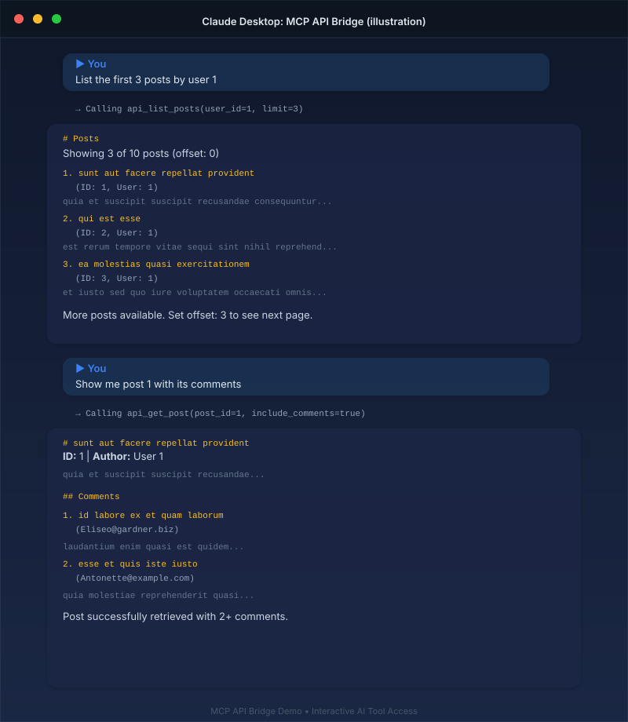

# REST API to MCP Server Bridge

[](https://github.com/BryceEWatson/mcp-api-bridge/actions/workflows/ci.yml)

A small Python example of wrapping a REST API as MCP tools, so Claude, Cursor and other MCP clients can call it with validated input. MCP (Model Context Protocol) is the standard those assistants use to discover and call external tools.

I built it around [JSONPlaceholder](https://jsonplaceholder.typicode.com), a free fake REST API, and exposed four tools: list, get, create and update posts. The point is the pattern. Swap the API client for your own and the tool wiring, validation and error handling carry over.

---

<p align="center">
  
</p>

## What it does

An MCP client gets typed tools with JSON schemas it can read before calling them:

```
You: "List the first 5 posts by user 3"

Claude calls: api_list_posts(user_id=3, limit=5)
→ Fetches GET /posts and filters to userId 3
→ Returns a page of results with pagination info

You: "Create a post about MCP servers"

Claude calls: api_create_post(title="Why MCP Servers Matter", body="...", user_id=1)
→ Sends POST /posts with the validated payload
→ Returns the created resource
```

Bad input (a limit of 0, an empty title, an update with no fields) is rejected before any HTTP request goes out, and the client gets an MCP error result (`isError: true`) it can act on.

## Quick start

**Prerequisites:** Python 3.10 or newer and [uv](https://docs.astral.sh/uv/).

```bash
git clone https://github.com/BryceEWatson/mcp-api-bridge.git
cd mcp-api-bridge
uv sync --extra dev

# Run the offline tests (HTTP is mocked)
uv run pytest -m "not live"

# Run the server over stdio
uv run api-bridge
```

The server speaks MCP over stdin and stdout, so running it by hand just waits for a client. To try it in Claude Desktop, add this to your `claude_desktop_config.json` and restart Claude Desktop:

```json
{
  "mcpServers": {
    "api-bridge": {
      "command": "uv",
      "args": ["run", "--directory", "/path/to/mcp-api-bridge", "api-bridge"]
    }
  }
}
```

If Claude Desktop can't find `uv`, use its full path (`which uv` on macOS and Linux, `where uv` on Windows), since desktop apps don't always see your shell's PATH. On Windows, write the `--directory` path with forward slashes.

If you'd rather use pip, `python -m venv .venv`, activate it, then `pip install -e ".[dev]"`. `uv.lock` pins the exact versions CI tests against.

## The tools

| Tool | Method | What it does | Annotations |
|------|--------|--------------|-------------|
| `api_list_posts` | GET /posts | List posts, filter by user, paginate | read-only, idempotent |
| `api_get_post` | GET /posts/{id} | Fetch one post, optionally with its comments | read-only, idempotent |
| `api_create_post` | POST /posts | Create a post | writes, not idempotent, not destructive (only adds) |
| `api_update_post` | PATCH /posts/{id} | Change some fields of a post | writes, idempotent, destructive (overwrites fields) |

All four set `openWorldHint` because they call an outside service. The list and get tools take `response_format`: `"markdown"` for something a person reads, `"json"` for something a program parses.

Annotations are hints a client can use to decide when to ask the user before a call. The MCP spec tells clients to treat them as untrusted unless the server is trusted, so they don't replace a client's own confirmation rules. JSONPlaceholder fakes its writes, so nothing actually changes on the demo API.

## Security notes

I wrote these down because they're the questions I'd ask of any MCP server before connecting it to an assistant.

**What the server does:**

- **No server-side request forgery from tool input.** The base URL is set in code by whoever runs the server. Tools only build paths from integer IDs that the schema has already checked (`post_id >= 1`), so a model can't make the server call another host or path. httpx doesn't follow redirects by default and the client keeps it that way.
- **Input is validated at the protocol boundary.** Every parameter has a type and bounds in the JSON schema, and FastMCP enforces it before the tool runs. Titles and bodies are stripped, so whitespace-only strings are rejected. Tests check that rejected calls send no HTTP request at all.
- **Errors are real MCP errors.** API failures raise `ToolError`, so the client sees `isError: true` instead of an error string dressed up as a success. HTTP and network errors get a short actionable message. Anything unexpected is logged to stderr and reported as a generic error, so stack traces and response bodies don't end up in the model's context.
- **Timeouts.** Connect, read, write and pool each time out after 30 seconds by default. There's no overall deadline per request, so a server that keeps trickling bytes can hold a call open.
- **No credentials.** JSONPlaceholder needs none, so there are no secrets in the repo. If you add a key, read it from the environment as in Step 1 below.

**What it doesn't handle (out of scope for this example):**

- **Prompt injection through tool output.** Post titles, bodies and comments go back to the model as-is. With a real API, that text may be written by someone other than your user, and the model can read instructions in it. The server doesn't sanitize or label it as untrusted, and the client has to treat tool output as data.
- **Response size.** `api_list_posts` loads the whole `/posts` response into memory before paging it, because JSONPlaceholder has no server-side paging. There's no cap on response size. Against a real API, page on the server and cap what you read.
- **Personal data passthrough.** `api_get_post` with comments returns commenter emails. A real integration should decide which fields the model needs to see.
- **Rate limiting and retries.** A 429 is reported to the client and not retried.
- **Authentication and authorization.** stdio runs as a local process for one user. If you switch to the HTTP transport, you need authentication in front of it.

## Adapting it for your API

### Step 1: Replace the API client

Edit `src/api_bridge_mcp/api_client.py`. Change the base URL and add your auth:

```python
class APIClient:
    def __init__(self, base_url: str = "https://api.your-service.com/v1", timeout: int = 30):
        self.base_url = base_url
        self.timeout = httpx.Timeout(timeout)
        self.headers = {"Authorization": f"Bearer {os.environ['YOUR_API_KEY']}"}
```

Pass `headers=self.headers` when the client creates its `httpx.AsyncClient`. The get, post, put and patch helpers stay the same. Keep the base URL under the operator's control rather than taking it from tool input, or you've built a request-forgery tool.

### Step 2: Register your tools

Each tool is an async function. Its parameters use `Annotated[type, Field(...)]`, and FastMCP turns those into the JSON schema the client sees and enforces it before your code runs:

```python
@mcp.tool(
    name="orders_search",
    description="Search orders by customer and status.",
    annotations={"readOnlyHint": True, "destructiveHint": False, "idempotentHint": True, "openWorldHint": True},
)
async def orders_search(
    customer_id: Annotated[Optional[str], Field(description="Filter by customer", max_length=64)] = None,
    status: Annotated[Optional[Literal["pending", "shipped", "delivered"]], Field(description="Filter by status")] = None,
    limit: Annotated[int, Field(description="Results per page", ge=1, le=100)] = 20,
) -> str:
    query = {k: v for k, v in {"customer_id": customer_id, "status": status}.items() if v is not None}
    try:
        async with APIClient() as client:
            orders = await client.get("/orders", params=query)
            return format_orders(orders[:limit])
    except Exception as e:
        _raise_tool_error("searching orders", e)
```

`_raise_tool_error` passes a `ToolError` you raise yourself through unchanged, turns HTTP errors into short messages, and reports anything else generically.

Set the annotations to match what the tool really does. A tool that overwrites or deletes data should say `destructiveHint: True`.

### Step 3: Update the Claude Desktop config

Point the config at your server and restart the client.

## Project structure

```
mcp-api-bridge/
├── .github/workflows/ci.yml       ← lint and tests on every push and pull request
├── pyproject.toml                 ← packaging, dependency ranges, pytest and ruff config
├── uv.lock                        ← exact versions CI installs
├── claude_desktop_config.json     ← example Claude Desktop config
├── src/api_bridge_mcp/
│   ├── api_client.py              ← HTTP client (swap this for your API)
│   └── server.py                  ← the four MCP tools
└── tests/
    ├── conftest.py                ← shared fixtures and sample data
    ├── test_client.py             ← API client tests (HTTP mocked)
    ├── test_tools.py              ← tool and validation tests (HTTP mocked)
    └── test_e2e_mcp.py            ← MCP protocol tests, some live
```

The API layer (`api_client.py`) is separate from the MCP layer (`server.py`). To adapt it, you mostly change the client and the tool functions; the FastMCP wiring stays the same.

## Design decisions

**JSONPlaceholder as the demo API.** No auth, no signup, full CRUD, and it's obviously a stand-in, so the pattern is the focus.

**Python and FastMCP.** FastMCP is the high-level server in the official MCP Python SDK. It handles tool registration, schema generation and transport. I've pinned the SDK below 2.0, because 2.x renamed FastMCP to `MCPServer`; moving to it is a separate change.

**stdio transport.** It's the default for local MCP servers. The SDK also supports streamable HTTP for remote use, which needs the authentication noted above.

**Pydantic constraints on every parameter.** The client sees the bounds in the schema before it calls, and the server enforces the same bounds.

**Two response formats.** Markdown for a person reading the assistant's answer, JSON for a program.

## Running tests

```bash
# Offline: client, tool, validation, schema and annotation tests. HTTP is mocked.
uv run pytest -m "not live"

# Live: real calls to JSONPlaceholder, including a full session over stdio
uv run pytest -m live

# Lint
uv run ruff check src tests
```

[CI](.github/workflows/ci.yml) runs lint and the offline tests on Python 3.10 through 3.13 on Linux, the offline tests on Windows and macOS, the offline tests again with the oldest dependency versions `pyproject.toml` allows, and the live tests once against JSONPlaceholder. The live job depends on that public service being up.

## Built with

- [MCP Python SDK](https://github.com/modelcontextprotocol/python-sdk) (FastMCP)
- [httpx](https://www.python-httpx.org/) for async HTTP
- [Pydantic v2](https://docs.pydantic.dev/) for validation
- [JSONPlaceholder](https://jsonplaceholder.typicode.com) as the demo API
- [pytest](https://docs.pytest.org/), [pytest-httpx](https://github.com/Colin-b/pytest_httpx) and [ruff](https://docs.astral.sh/ruff/)

## About

I'm Bryce Watson. I build AI tooling and MCP servers. More at [brycewatson.com](https://brycewatson.com) and [github.com/BryceEWatson](https://github.com/BryceEWatson).

MIT licensed.
